# Laboratorio de seguridad en PHP con OpenSSL y Sodium

<p align="center">
  
  
  
  
</p>
<p align="center">
  
  
  
  
</p>

<p align="center"><strong>🔐 Cifrado AES-128-CBC · ✍️ Firmas RSA/SHA-256 · 📜 Certificados X.509 · 🛡️ Cifrado autenticado con Sodium</strong></p>


**Universidad Tecnológica de Panamá**  
**Facultad:** Facultad de Ciencias de la Computacion  
**Campus:** Víctor Levi Sasso  
**Asignatura:** Desarrollo de Web  
**Docente:** Ing. Irina Fong  
**Tema:** Programación segura según OWASP — protección de datos  
**Estudiante(s):** Andres Dommar E-8-180720  
Dylan Pitti 8-1024-553
**Fecha de realización:** 30 de octubre de 2026

## Índice

1. [🔐 Introducción](#1-introducción)
2. [🎯 Objetivos](#2-objetivos)
3. [🧰 Herramientas y requisitos](#3-herramientas-y-requisitos)
4. [📁 Estructura del proyecto](#4-estructura-del-proyecto)
5. [⚙️ Instalación y ejecución en WampServer](#5-instalación-y-ejecución-en-wampserver)
6. [🧪 Desarrollo de los programas](#6-desarrollo-de-los-programas)
7. [🔑 Funciones criptográficas utilizadas](#7-funciones-criptográficas-utilizadas)
8. [🛡️ Seguridad y recomendaciones de OWASP](#8-seguridad-y-recomendaciones-de-owasp)
9. [🛠️ Dificultades y soluciones](#9-dificultades-y-soluciones)
10. [✅ Verificaciones finales](#10-verificaciones-finales)
11. [📌 Resultados y conclusión](#11-resultados-y-conclusión)
12. [📚 Referencias](#12-referencias)

## 1. Introducción

En este laboratorio se trabajó con la extensión **OpenSSL de PHP** para comprender cómo utilizar distintas funciones criptográficas que permiten cifrar información, crear firmas digitales y verificar si un mensaje ha sido modificado. Se partió de los programas proporcionados en un repositorio de ejemplo y se realizaron modificaciones para incorporar **formularios HTML**, de modo que los datos pudieran ingresarse desde el navegador y no quedaran escritos directamente en el código.

También se adaptaron las rutas de configuración para WampServer, se generaron claves RSA y un certificado X.509 autofirmado, y se añadieron pruebas que comparan el mensaje original con otro alterado. Finalmente, se desarrolló un quinto ejemplo con **Sodium**, para demostrar cómo funciona el cifrado autenticado y cómo se rechazan datos cifrados que han sido modificados. Estas actividades se relacionan con los principios de confidencialidad e integridad tratados en programación segura y OWASP.

## 2. Objetivos

- Ejecutar y adaptar los cuatro ejemplos de PHP proporcionados para el laboratorio, incorporando formularios para recibir los datos.
- Utilizar OpenSSL para cifrar y descifrar mensajes con AES-128-CBC.
- Generar claves RSA, firmar mensajes con SHA-256 y verificar sus firmas digitales.
- Crear un certificado X.509 autofirmado y utilizarlo para comprobar una firma.
- Implementar con Sodium un ejemplo de cifrado autenticado y detección de alteraciones.
- Documentar las funciones utilizadas y verificar los resultados mediante capturas de pantalla.

## 3. Herramientas y requisitos

El laboratorio se realizó localmente en Windows usando **WampServer** y **Visual Studio Code**, sin utilizar Laravel, Composer, MySQL ni una base de datos.

| Herramienta | Versión o descripción | Uso |
| --- | --- | --- |
| 🐘 **PHP** | **8.5.0** | Ejecución de los programas y formularios PHP |
| 🔒 **OpenSSL** | **3.5.4** (verificado desde PHP CLI) | Cifrado, RSA, firmas y certificados |
| 🔐 Extensión `openssl` | Habilitada | Funciones `openssl_*` |
| 🛡️ Extensión `sodium` | Habilitada | Cifrado autenticado mediante `secretbox` |
| 🌐 **WampServer / Apache** | Entorno local | Servir las páginas PHP en `localhost` |
| 💻 **Visual Studio Code** | Editor de código | Edición de los archivos y comprobaciones |

Para confirmar las extensiones y la versión de OpenSSL, se ejecutaron los siguientes comandos **en PowerShell**, dentro del proyecto:

```powershell
cd C:\wamp64\www\SeguridadOpenSSL-main
php -m | Select-String "openssl|sodium"
php -r "echo OPENSSL_VERSION_TEXT, PHP_EOL;"
```

El resultado mostró `openssl` y `sodium` habilitados, además de `OpenSSL 3.5.4 30 Sep 2025`.

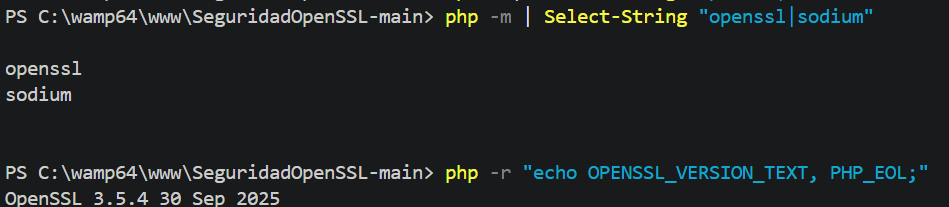

> Esta comprobación corresponde a PHP desde la terminal. Para servir los formularios, también es necesario que las extensiones estén habilitadas en la versión de PHP utilizada por Apache.

## 4. Estructura del proyecto

Los cinco ejercicios están disponibles desde `index.php`, utilizando una hoja de estilos compartida. El archivo `FirmarMensaje.php` lleva el nombre corregido; en el repositorio original aparecía una variante escrita de forma diferente.

```text
SeguridadOpenSSL-main/
├── index.php
├── Encriptacion.php
├── firma7.php
├── firmaOtra.php
├── FirmarMensaje.php
├── Sodium.php
├── estilo.css
├── capturas/
│   └── (evidencias del laboratorio)
├── .gitignore
└── README.md
```

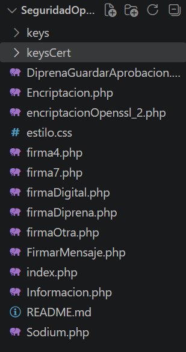

La carpeta original también contenía otros ejemplos del repositorio base. **No son necesarios para ejecutar los cinco ejercicios documentados aquí.** En esta copia de entrega se incluyeron únicamente los archivos utilizados y las evidencias, sin claves privadas.

### 🏠 Página de inicio

`index.php` contiene enlaces para ejecutar los programas en el orden de la práctica. `firmaOtra.php` debe ejecutarse **antes** de `FirmarMensaje.php` porque este último utiliza el certificado y la clave generados previamente.

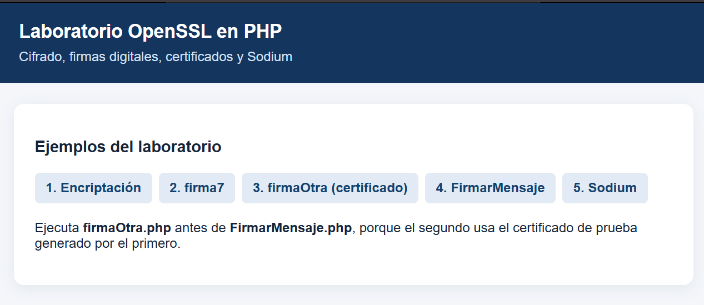

## 5. Instalación y ejecución en WampServer

1. Tener WampServer instalado, iniciar Apache y comprobar que su icono indique que los servicios necesarios están activos.
2. Extraer esta carpeta dentro de `C:\wamp64\www\` con el nombre `SeguridadOpenSSL-main`.
3. Comprobar que PHP tenga habilitadas las extensiones `openssl` y `sodium`.
4. Abrir en el navegador: **http://localhost/SeguridadOpenSSL-main/**.
5. Utilizar los botones para entrar a cada programa. Los formularios se envían mediante el método `POST` al mismo archivo PHP.

En `firma7.php` y `firmaOtra.php` se utiliza el archivo `openssl.cnf` de WampServer **solo cuando existe** la ruta configurada:

```text
C:\wamp64\bin\php\php8.5.0\extras\ssl\openssl.cnf
```

Puedes verificar su presencia desde PowerShell:

```powershell
Test-Path "C:\wamp64\bin\php\php8.5.0\extras\ssl\openssl.cnf"
```

Si la ruta no existe en otro equipo, se deberá ajustar a su instalación y comprobar la configuración de OpenSSL; no se debe asumir que todos los equipos tienen la misma carpeta.

### 🔑 Almacenamiento de claves de prueba

Los programas que generan claves las guardan en una ubicación separada del directorio web, en este equipo:

```text
C:\wamp64\openssl-lab-private\
├── keys\
│   ├── private_key.pem
│   ├── public_key.pem
│   └── signature.dat
└── keysCert\
    ├── privkey.pem
    └── certout.pem
```

Estas carpetas se crean al ejecutar los ejemplos correspondientes. **No están incluidas en el repositorio y no deben publicarse en GitHub**, especialmente los archivos de claves privadas. El nombre `certout.pem` se utiliza porque el archivo contiene un certificado PEM y no una solicitud CSR.

## 6. Desarrollo de los programas

### 🔐 6.1. `Encriptacion.php` — Cifrado y descifrado AES-128-CBC

Este primer programa recibe un mensaje desde un formulario HTML y lo cifra utilizando **AES-128-CBC**. La clave secreta se genera de forma aleatoria con 16 bytes, mientras que el vector de inicialización (IV) también se genera aleatoriamente con la longitud requerida por el algoritmo.

Posteriormente, el programa utiliza `openssl_decrypt()` con la misma clave y el mismo IV para recuperar el texto y compararlo con el mensaje original.

```php
$algoritmo = 'AES-128-CBC';
$clave = random_bytes(16);
$iv = random_bytes(openssl_cipher_iv_length($algoritmo));
$cifrado = openssl_encrypt($texto, $algoritmo, $clave, 0, $iv);
$descifrado = openssl_decrypt($cifrado, $algoritmo, $clave, 0, $iv);
```

**Resultado observado:** el mensaje `Mensaje secreto` se cifró, se presentó en Base64 y se recuperó correctamente, por lo que el programa indicó que el texto descifrado coincidía con el original.

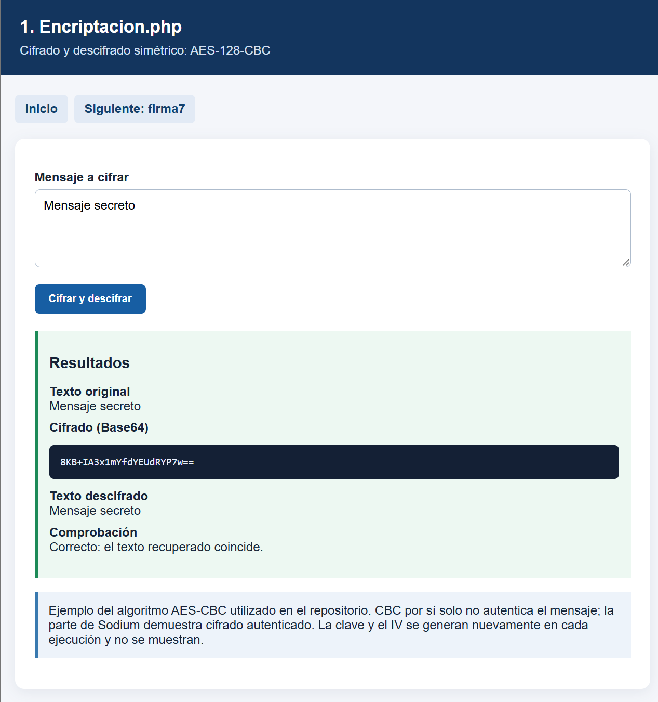

**Observación:** AES-CBC por sí solo no autentica el contenido. Este ejemplo demuestra confidencialidad y recuperación del texto, pero la detección de alteraciones se muestra posteriormente con Sodium.

### ✍️ 6.2. `firma7.php` — Firma digital con RSA y SHA-256

Este programa permite escribir un mensaje, generar un par de claves **RSA de 2048 bits** y firmar la información utilizando `openssl_sign()` con SHA-256. Luego se utiliza la clave pública y `openssl_verify()` para comprobar si la firma corresponde al mensaje.

La prueba realiza dos verificaciones con **la misma firma original y la misma clave pública**:

- **Mensaje original:** `openssl_verify()` devuelve `1`, que indica firma válida.
- **Mensaje modificado:** al agregar `[alterado]` sin generar una nueva firma, devuelve `0`, que indica firma inválida.

También se calculan huellas SHA-256 de los dos textos para visualizar el cambio; estas huellas se muestran como apoyo didáctico, **no sustituyen la verificación criptográfica de `openssl_verify()`**.

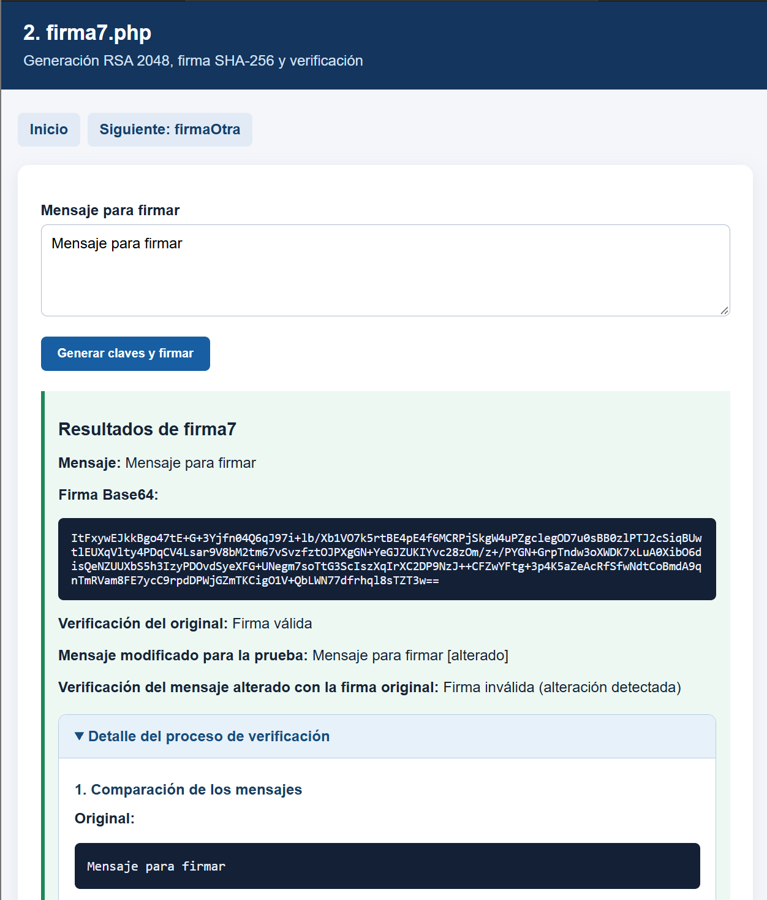

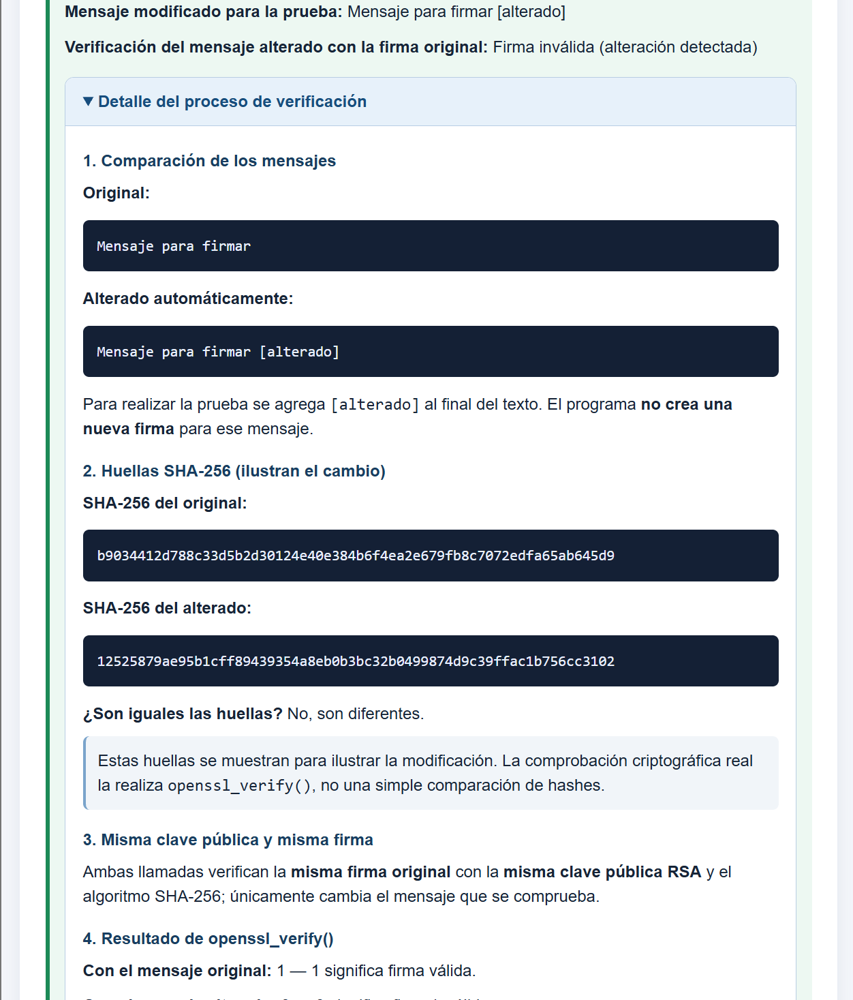

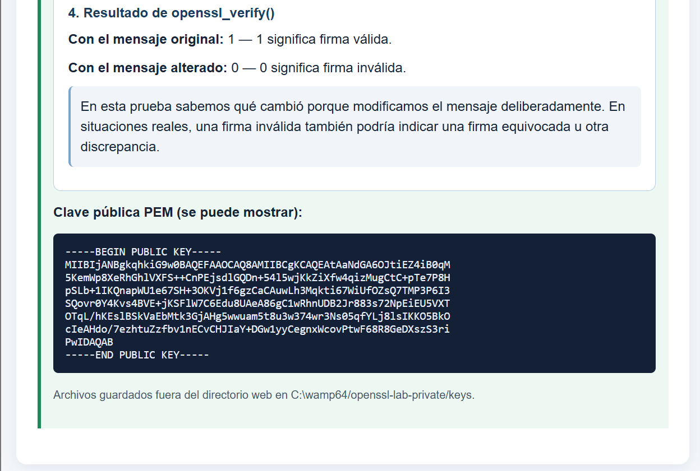

Una firma digital no cifra el mensaje ni oculta su contenido. Permite comprobar que la firma corresponde a los datos y a la clave pública utilizada.

### 📜 6.3. `firmaOtra.php` — Certificado X.509 autofirmado

En este programa se agregó un formulario que permite introducir los datos de identificación del certificado: país, provincia, localidad, organización, nombre común y correo de prueba.

El script genera un par de claves RSA, crea una solicitud de firma de certificado (CSR) con `openssl_csr_new()` y genera un certificado **X.509 autofirmado** con `openssl_csr_sign()`. La validez establecida en la prueba es de 365 días.

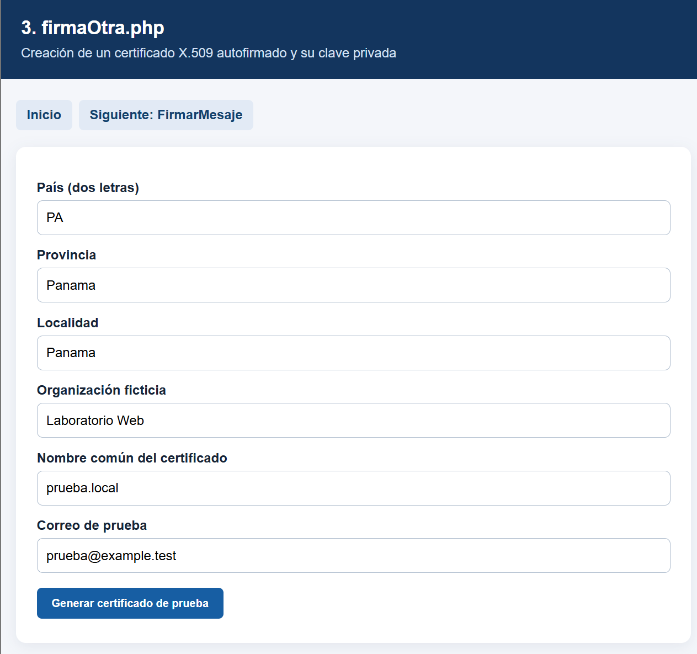

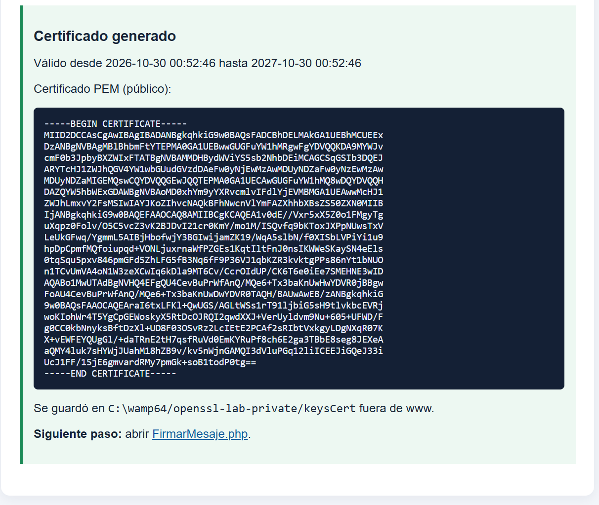

El certificado se guarda como `certout.pem` junto con su clave privada `privkey.pem` dentro de la carpeta externa `openssl-lab-private/keysCert`. El certificado público puede mostrarse, pero **la clave privada no debe publicarse**.

Este certificado es de prueba y autofirmado: **no demuestra que su identidad haya sido validada por una autoridad certificadora confiable**.

### 🖊️ 6.4. `FirmarMensaje.php` — Firma y verificación con certificado

Este programa utiliza la clave privada y el certificado generados en `firmaOtra.php`. Recibe un mensaje mediante formulario, firma el texto con RSA/SHA-256 y obtiene la clave pública del certificado para verificarlo.

También se añade `[alterado]` al mensaje original y se comprueba nuevamente con la misma firma. La interfaz incluye un apartado desplegable llamado **Detalle del proceso de verificación**, donde aparecen los mensajes, sus huellas SHA-256 y los resultados de `openssl_verify()`.

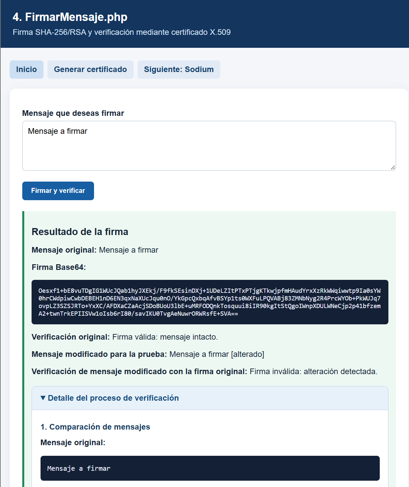

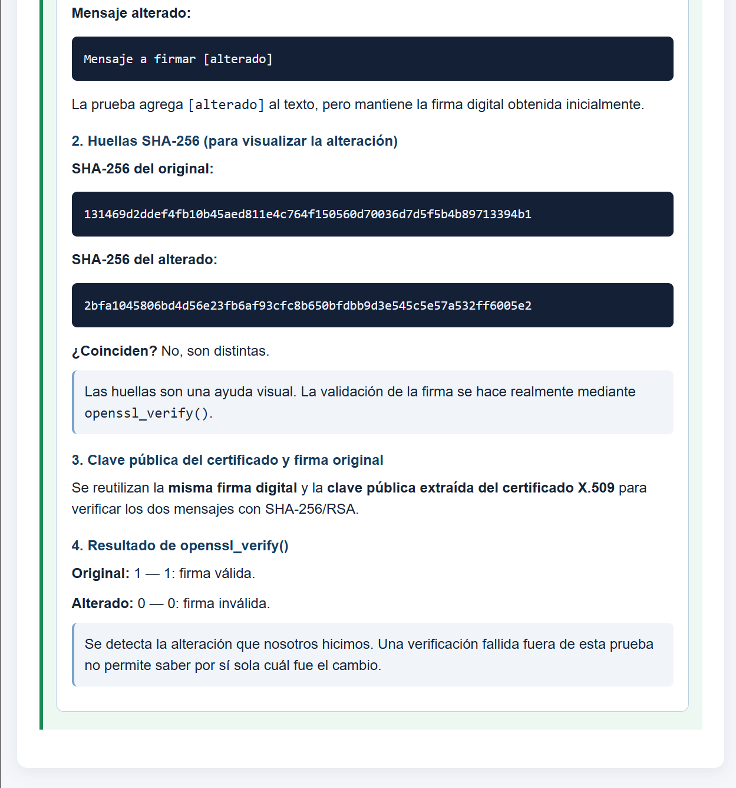

**Resultado observado:** firma válida para el original y firma inválida al modificar el contenido. La detección se demuestra porque la alteración fue realizada intencionalmente durante la prueba.

### 🛡️ 6.5. `Sodium.php` — Cifrado autenticado y detección de alteraciones

Como actividad adicional se creó un ejemplo mediante **Libsodium**, utilizando la extensión Sodium incluida en PHP moderno. En este programa se genera una clave temporal, un *nonce* aleatorio y un mensaje cifrado autenticado mediante `sodium_crypto_secretbox()`.

Después se descifra el contenido original utilizando `sodium_crypto_secretbox_open()`. Para probar su integridad se modifica un bit del último byte del contenido cifrado y se intenta descifrar otra vez, conservando la clave y el nonce:

```php
$clave = sodium_crypto_secretbox_keygen();
$nonce = random_bytes(SODIUM_CRYPTO_SECRETBOX_NONCEBYTES);
$cifrado = sodium_crypto_secretbox($mensaje, $nonce, $clave);
$recuperado = sodium_crypto_secretbox_open($cifrado, $nonce, $clave);

$alterado = $cifrado;
$indice = strlen($alterado) - 1;
$alterado[$indice] = chr(ord($alterado[$indice]) ^ 1);
$verificacionAlterada = sodium_crypto_secretbox_open($alterado, $nonce, $clave);
```

**Resultados observados:** el cifrado original se descifró correctamente. Después de modificar un bit, `sodium_crypto_secretbox_open()` devolvió `false`, de modo que el programa rechazó el contenido alterado sin entregar un texto descifrado.

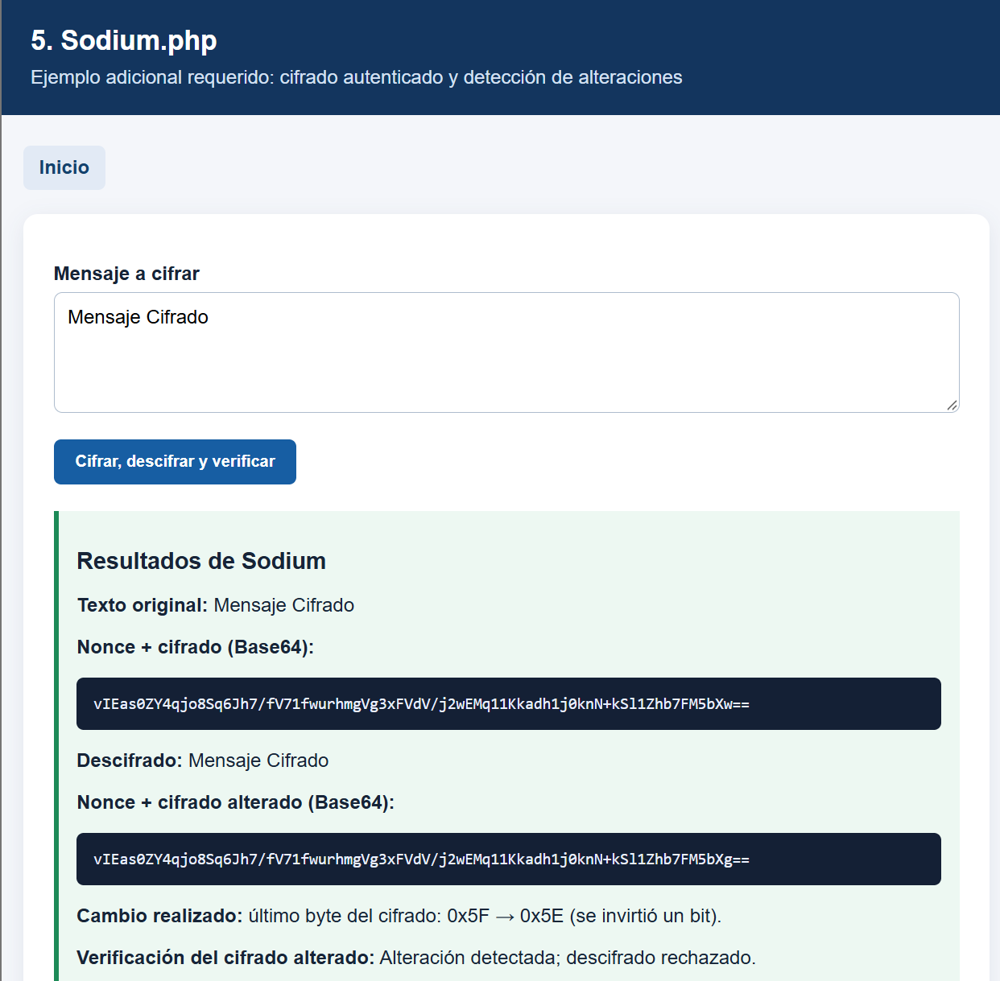

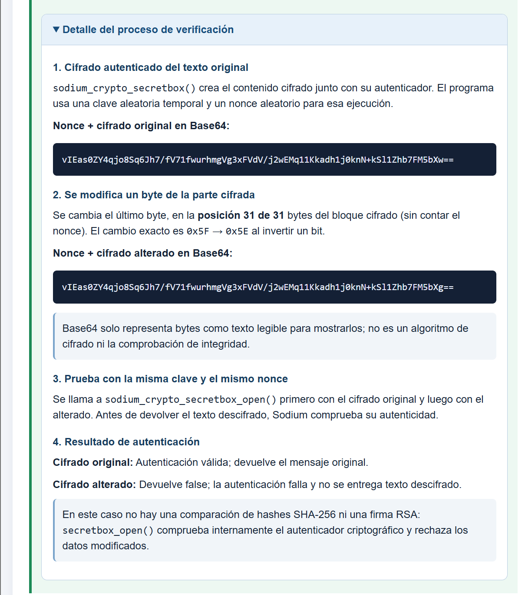

A diferencia de AES-CBC utilizado sin autenticación en el primer ejercicio, `secretbox` comprueba la autenticidad del contenido cifrado antes de devolver el mensaje. Base64 se usa únicamente para presentar los bytes cifrados como texto; **no es un algoritmo de cifrado**.

## 7. Funciones criptográficas utilizadas

| Función | Propósito en el laboratorio |
| --- | --- |
| `random_bytes()` | Generar claves, IV y nonces con bytes aleatorios seguros. |
| `openssl_cipher_iv_length()` | Obtener la longitud del IV requerida por AES-CBC. |
| `openssl_encrypt()` | Cifrar el mensaje con AES-128-CBC. |
| `openssl_decrypt()` | Recuperar el mensaje cifrado con la clave y el IV. |
| `openssl_pkey_new()` | Generar las claves RSA de prueba. |
| `openssl_pkey_get_details()` / `openssl_pkey_export()` | Obtener la clave pública y exportar material de claves. |
| `openssl_sign()` | Crear una firma digital con la clave privada y SHA-256. |
| `openssl_verify()` | Verificar la firma con la clave pública; devuelve `1`, `0` o `-1`. |
| `openssl_csr_new()` | Generar la solicitud CSR con los datos del certificado. |
| `openssl_csr_sign()` | Crear el certificado X.509 autofirmado. |
| `openssl_x509_export()` / `openssl_x509_parse()` | Exportar el certificado PEM y consultar sus datos. |
| `hash('sha256', ...)` | Calcular huellas para mostrar la diferencia entre mensajes. |
| `sodium_crypto_secretbox_keygen()` | Generar una clave secreta para el ejemplo de Sodium. |
| `sodium_crypto_secretbox()` | Cifrar y autenticar un mensaje. |
| `sodium_crypto_secretbox_open()` | Verificar la autenticidad y descifrar, o devolver `false` si falla. |
| `sodium_memzero()` | Intentar borrar de memoria la clave temporal al terminar la prueba. |

Fragmentos del código utilizado:

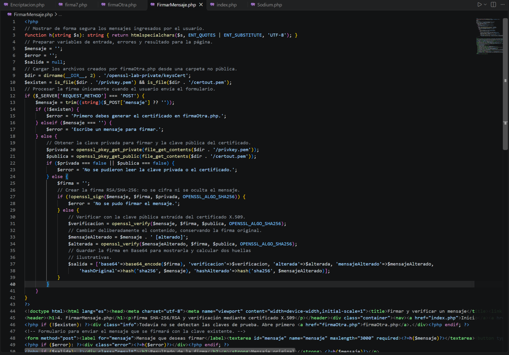

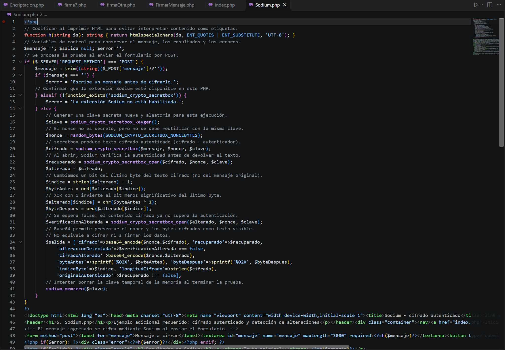

## 8. Seguridad y recomendaciones de OWASP

Los ejercicios permiten observar algunas buenas prácticas, como la generación de claves aleatorias, la validación básica de entradas, el uso de `htmlspecialchars()` antes de mostrar datos recibidos y la separación de las claves privadas del directorio web.

También es importante considerar estas limitaciones:

- Los programas son **demostraciones locales**, no aplicaciones listas para producción.
- El ejemplo AES-CBC no incluye autenticación del mensaje. Para aplicaciones reales se recomiendan modos autenticados o una construcción de cifrado autenticado adecuada.
- Las claves privadas RSA de prueba se exportan sin contraseña y se guardan como archivos locales. No deben exponerse, compartirse ni reutilizarse en sistemas reales.
- Las claves y el nonce del ejemplo Sodium son nuevos en cada ejecución; no se implementa almacenamiento permanente de claves.
- El certificado X.509 generado es autofirmado y no proporciona confianza de una autoridad certificadora pública.
- El directorio privado no debe publicarse ni colocarse dentro de `www`.

La [guía de OWASP para almacenamiento criptográfico](https://cheatsheetseries.owasp.org/cheatsheets/Cryptographic_Storage_Cheat_Sheet.html) recomienda evitar almacenar datos sensibles innecesarios, utilizar bibliotecas confiables y preferir cifrado autenticado cuando sea posible.

## 9. Dificultades y soluciones

| Dificultad | Solución utilizada |
| --- | --- |
| Rutas de `openssl.cnf` originalmente orientadas a otra instalación de Windows. | Se adaptaron a WampServer y se utiliza la ruta solo si el archivo existe. |
| Programas con mensajes escritos directamente en las variables PHP. | Se implementaron formularios HTML con `method="post"`. |
| No se observaba qué se modificaba en las pruebas de firmas. | Se mostraron los mensajes originales y alterados, sus huellas SHA-256 y el resultado de `openssl_verify()`. |
| En Sodium solo aparecía «alteración detectada». | Se agregó un desglose que muestra el byte alterado y el resultado de `sodium_crypto_secretbox_open()`. |
| El archivo original se llamaba `FirmarMesaje.php`. | Se cambió a `FirmarMensaje.php` y se actualizaron los enlaces internos. |
| Riesgo de publicar las claves privadas de prueba. | Los archivos nuevos se almacenan fuera de `www` y se excluyen de la copia para GitHub. |

## 10. Verificaciones finales

Para comprobar la sintaxis desde **PowerShell**, en la raíz del proyecto se ejecutan:

```powershell
php -l index.php
php -l Encriptacion.php
php -l firma7.php
php -l firmaOtra.php
php -l FirmarMensaje.php
php -l Sodium.php
```

El resultado esperado de cada archivo es `No syntax errors detected ...`. Este comando revisa la **sintaxis**, no sustituye las pruebas funcionales realizadas desde el navegador.

| Programa | Comprobación funcional observada |
| --- | --- |
| `Encriptacion.php` | El texto descifrado coincide con el original. |
| `firma7.php` | Firma original válida; firma inválida cuando cambia el mensaje. |
| `firmaOtra.php` | Certificado X.509 autofirmado generado. |
| `FirmarMensaje.php` | Firma verificada mediante el certificado; alteración detectada. |
| `Sodium.php` | Descifrado original correcto; contenido cifrado alterado rechazado. |

## 11. Resultados y conclusión

Durante el desarrollo de este laboratorio pude aprender sobre cómo utilizar diferentes funciones criptográficas de PHP con OpenSSL y Sodium para proteger información y comprobar si ha sido modificada. Pude comprender mejor la diferencia entre el cifrado y la firma digital, ya que el primero permite mantener la confidencialidad de los datos, mientras que la segunda ayuda a verificar la integridad del mensaje mediante una clave pública y su firma correspondiente.

También pude observar la importancia de generar correctamente las claves, utilizar los valores de IV o nonce adecuados y proteger los archivos privados. Las pruebas con los mensajes alterados permitieron comprobar que incluso una modificación pequeña provoca el rechazo de una firma, mientras que el ejemplo de Sodium demostró cómo el cifrado autenticado detecta cambios en el contenido cifrado antes de devolver el mensaje. Estas prácticas ayudaron a comprender la importancia de implementar mecanismos criptográficos adecuados al desarrollar aplicaciones web.

## 12. Referencias

- PHP Documentation Group. (s. f.). [OpenSSL — Manual de PHP](https://www.php.net/manual/es/book.openssl.php).
- PHP Documentation Group. (s. f.). [Sodium — Manual de PHP](https://www.php.net/manual/es/book.sodium.php).
- PHP Documentation Group. (s. f.). [`openssl_sign()`](https://www.php.net/manual/es/function.openssl-sign.php) y [`openssl_verify()`](https://www.php.net/manual/es/function.openssl-verify.php).
- PHP Documentation Group. (s. f.). [`sodium_crypto_secretbox()`](https://www.php.net/manual/es/function.sodium-crypto-secretbox.php) y [`sodium_crypto_secretbox_open()`](https://www.php.net/manual/es/function.sodium-crypto-secretbox-open.php).
- OWASP Foundation. (s. f.). [Cryptographic Storage Cheat Sheet](https://cheatsheetseries.owasp.org/cheatsheets/Cryptographic_Storage_Cheat_Sheet.html).
- [Repositorio original de ejemplos SeguridadOpenSSL](https://github.com/Salomon2514/SeguridadOpenSSL). Base de los cuatro programas iniciales, adaptados para esta práctica.
